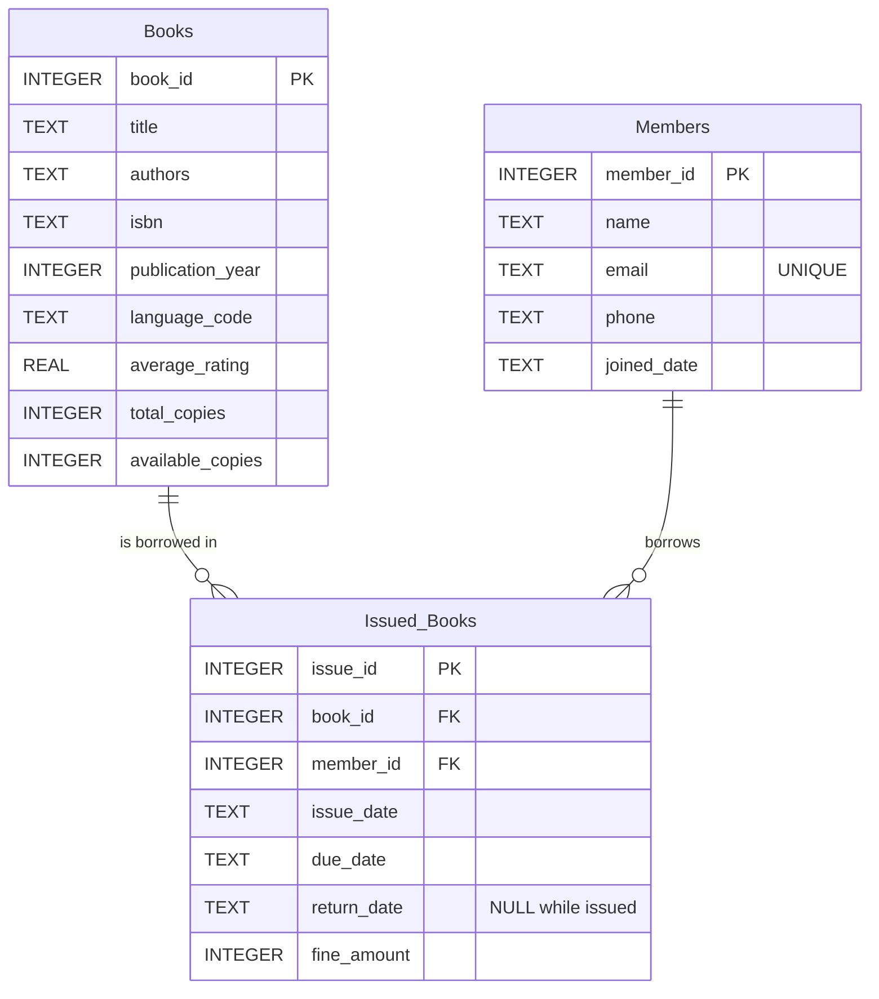

# 📚 Library Management System

A complete Library Management System built with **Python**, **SQLite** and **Streamlit**, running on a real dataset of **10,000 books** (Goodbooks-10k from Kaggle).

Manage books and members, issue and return books, track due dates, and calculate late fines, from a clean web app or from the command line.


---

## 🎯 Problem Statement

Managing a library by hand causes real problems:

- It is hard to keep records of hundreds or thousands of books.
- Finding a particular book takes a lot of time.
- It is difficult to track which books are issued and which are returned.
- Student borrowing records are hard to maintain.
- Overdue books are hard to spot, and fines are hard to calculate.

This project solves these problems with a digital system backed by a relational database.

## ✨ Features

| Area | What you can do |
|---|---|
| **Book management** | Add, update, delete and search books (by title, author, ISBN or book ID) |
| **Member management** | Add, update, delete and list members, with email validation |
| **Issuing books** | Record which member borrowed which book (14-day loan period) |
| **Returning books** | Availability updates automatically when a book comes back |
| **Due date tracking** | See every issued book with its due date and days overdue |
| **Fine management** | ₹2 per day after the due date, shown before the return is confirmed |
| **Availability tracking** | Check whether a book is available, or when the next copy is due back |
| **Borrowing history** | Full record of everything a member has borrowed, with fines |
| **Dashboard** | Totals for books, members, issued and overdue books, and fines collected |

### Built-in safety rules
- A book cannot be issued if no copies are available.
- A member cannot borrow the same book twice at the same time.
- A book or member with borrowing history cannot be deleted, so records stay intact.
- Total copies cannot be set lower than the number of copies currently issued.
- Duplicate member emails are rejected.

## 🛠️ Tech Stack

- **Python 3**: application logic
- **SQLite**: relational database (included with Python, no setup needed)
- **Streamlit** and **pandas**: web interface
- **Goodbooks-10k** (Kaggle): real book data

## 🗂️ Database Design

Three tables linked with primary and foreign keys:



- `Issued_Books.book_id` references `Books.book_id`.
- `Issued_Books.member_id` references `Members.member_id`.
- A `NULL` `return_date` means the book is still issued.
- Indexes on title, authors and the foreign keys keep searches fast on 10,000 rows.

### Example query: currently issued books (JOIN across all three tables)

```sql
SELECT b.title, m.name AS member, ib.issue_date, ib.due_date
FROM Issued_Books ib
JOIN Books   b ON b.book_id   = ib.book_id
JOIN Members m ON m.member_id = ib.member_id
WHERE ib.return_date IS NULL
ORDER BY ib.due_date;
```

## 🚀 Getting Started

### 1. Clone the repository
```bash
git clone https://github.com/alok-kumar06/Library-Management-System.git
cd Library-Management-System
```

### 2. Install the requirements
```bash
pip install -r requirements.txt
```

### 3. Run the web app
```bash
streamlit run app.py
```
Your browser opens the app automatically. If `streamlit` is not recognized, use `python -m streamlit run app.py`.

### Or use the command-line menu
```bash
python library.py
```

## 📖 How to Use

1. **Members** page: Add a member.
2. **Search & Availability** page: Find a book and check if it is available.
3. **Issue & Return** page: Issue the book to the member (due in 14 days).
4. **Issued & Overdue** page: Watch due dates and running fines.
5. **Issue & Return** page: Return the book. Any fine is shown before you confirm.
6. **Member History** page: See everything a member has borrowed.

## 📁 Project Structure

```
Library-Management-System/
├── app.py            # Streamlit web interface
├── library.py        # Core logic + command-line menu
├── schema.sql        # Database tables and indexes
├── load_books.py     # Loads the Kaggle books.csv into the database
├── library.db        # SQLite database (10,000 books already loaded)
├── requirements.txt  # Python dependencies
└── README.md
```

## 🔄 Rebuilding the Database from the Dataset

`library.db` already contains the 10,000 books. To rebuild it from scratch:

1. Download `books.csv` from the [Goodbooks-10k dataset on Kaggle](https://www.kaggle.com/datasets/zygmunt/goodbooks-10k).
2. Put it in the project folder and delete the old `library.db`.
3. Run:
   ```bash
   python load_books.py books.csv
   ```

Each book is loaded with 3 copies by default.

## ⚙️ Configuration

The loan period and fine rate are two constants at the top of `library.py`:

```python
LOAN_DAYS = 14      # days a book can be kept
FINE_PER_DAY = 2    # ₹ per day after the due date
```

## 🔮 Future Improvements

- Login with separate roles for librarian and member
- Book reservations when all copies are issued
- A separate Authors table (the dataset stores authors as one text field)
- "Most borrowed books" and monthly reports
- Email reminders for overdue books

## 👤 Author
**Alok Kumar**
B.Tech Computer Science & Engineering (Data Science)

[](https://www.linkedin.com/in/alok-kumar-91b0a829b/)
[](https://github.com/alok-kumar06)

<p align="center">If you found this project useful, give it a ⭐</p>
